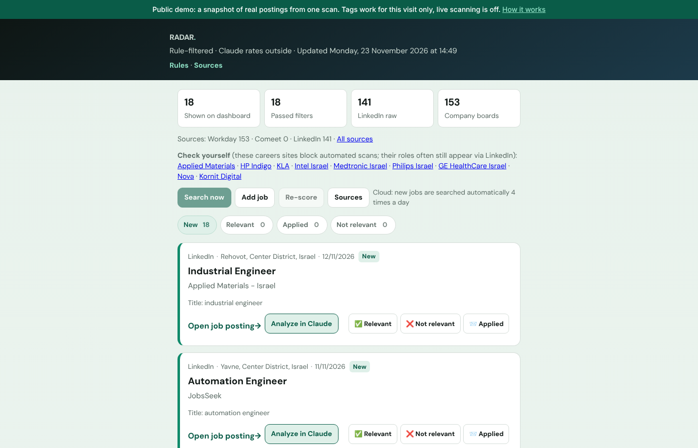
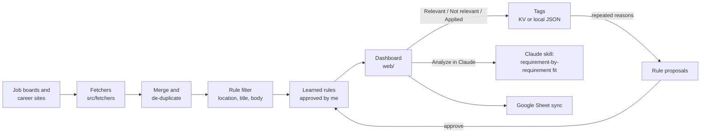

# RADAR: a personal job-search agent

**Live demo:** https://elroiosh.github.io/radar-showcase/ (a snapshot of real postings from one scan)

I'm a mechanical engineer looking for a Smart Manufacturing role in Israel. Checking LinkedIn, the Israeli job boards and dozens of company career sites every day took too long, and most of what I found wasn't relevant. So I built RADAR with Cursor and Claude. It collects openings from many sources, filters them against my profile, and learns from how I tag them.



## What it does

- **Collects** openings from LinkedIn and from company career sites on Workday, Comeet, Greenhouse, Lever and SmartRecruiters, with a time budget for each source. Fetchers for AllJobs, Drushim, JobMaster and Jooble are written but not switched on yet.
- **Filters** with clear rules: location, title, seniority, and a check of the description body. For example, an "Automation Engineer" title that turns out to mean software test automation gets dropped.
- **Learns from my tags.** I mark each job Relevant, Not relevant (with a reason) or Applied. When the same reason keeps coming up, RADAR suggests a new rule, and nothing changes until I approve it.
- **Hands off to Claude for deep analysis.** "Analyze in Claude" opens a new Claude chat with the full posting already filled in. A Claude skill then rates the job requirement by requirement against my real experience.
- **Runs in the cloud for free.** GitHub Actions scans 4 times a day and deploys to Cloudflare Pages behind Cloudflare Access. Tags are kept in Cloudflare KV, and jobs are synced to a Google Sheet.

## How it works



| Part | Where |
|---|---|
| Fetchers, one per source | `src/fetchers/` |
| Scan pipeline, time budget per source | `src/scan.ts` |
| Rule-based relevance filter | `src/relevance-filter.ts`, `config/search-profile.json` |
| Learning rules from tags | `src/rules-learn.ts`, `src/feedback.ts` |
| Dashboard | `src/dashboard-he.ts`, `web/` |
| Local API server | `src/server.ts` |
| Cloud API (Pages Functions + KV) | `functions/` |
| Scheduled scan and deploy | GitHub Actions |

## Decisions along the way

- **I took AI scoring out of the site.** An earlier version scored every job with Gemini, and the scores were too generous ("high fit" even when a core requirement was missing). Now the site only finds and filters. The deep rating happens in Claude, one job at a time, against a fixed fact base, and each score can be traced back to a specific requirement.
- **Rules are proposed, never applied on their own.** One wrong automatic rule could quietly hide good jobs for weeks.
- **Sites that block automated scans are linked, not scraped.** For Workday companies that block scans, and a few others, the dashboard shows a "Check yourself" link instead of a fetch that keeps failing.
- **Free only.** It runs on free tiers: GitHub Actions, Cloudflare Pages, KV and Access.

## Run it locally

```bash
npm install
cp .env.example .env      # optional keys: Jooble, Google Sheets, SMTP
npm run serve             # dashboard + API at http://localhost:8787
npm run daily             # full scan and dashboard rebuild
npm run build-demo        # static demo from the saved snapshot
npm test                  # relevance-filter regression tests
```

Edit `profile.yaml` and `config/search-profile.json` to search for a different profile.

## About this repository

This is a public snapshot of my private working repository. My tags, search history and personal details are not included, and the job data in `data/` is a saved set of public postings from a single scan.

Elroi Oshri · elroiosh@gmail.com
